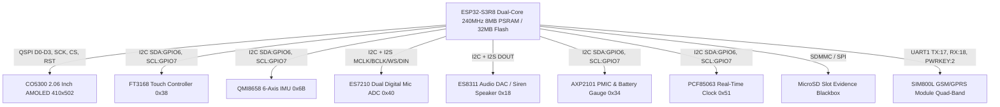
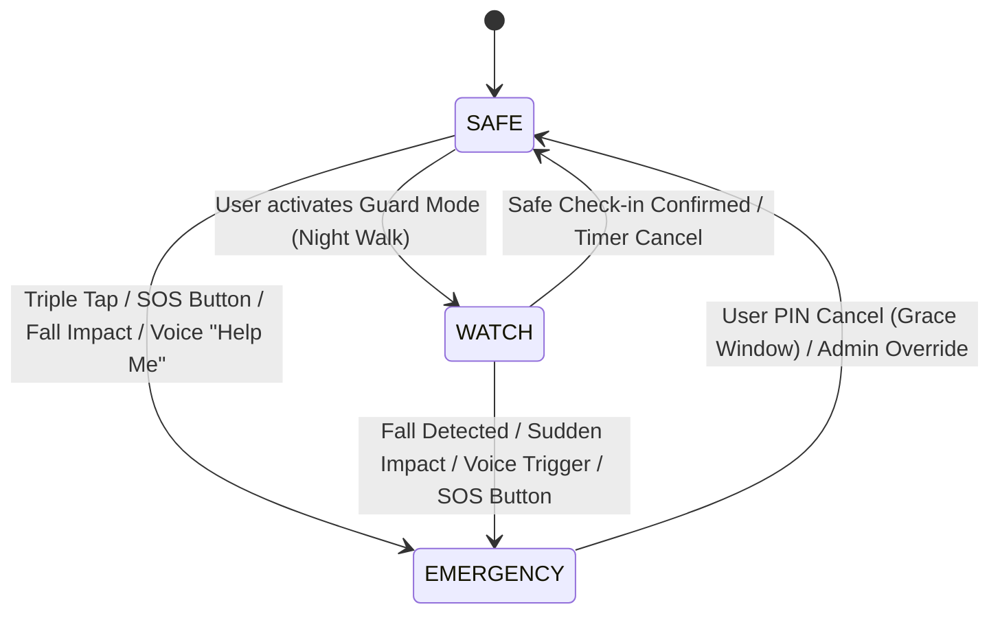

# SheShield Sentinel: Intelligent Wearable Safety & Distress System

**Project Architecture Proposal & Technical Specification**
**Platform:** Waveshare ESP32-S3-Touch-AMOLED-2.06 with SIM800L GSM/GPRS Fallback

---

## 1. Executive Summary

Personal safety devices often suffer from single points of failure: reliance on active smartphone Bluetooth tethering, lack of cellular coverage in underground transit or dead zones, delayed panic activation during rapid physical assault, or lack of admissible post-incident evidence.

**SheShield Sentinel** is an autonomous, standalone safety wearable engineered on the **Waveshare ESP32-S3-Touch-AMOLED-2.06** board. By combining on-device **ESP-SR offline voice detection**, **QMI8658 6-axis IMU fall/impact detection**, a **CO5300 2.06" AMOLED interactive HUD**, an **AXP2101 power manager**, **MicroSD blackbox audio logging**, and an external **SIM800L GSM module**, the system provides guaranteed emergency alerting without requiring a companion smartphone.

---

## 2. Hardware Architecture & Pinout Specification

### Pinout Mapping Table

| Peripherals | Pin / Bus | ESP32-S3 GPIO | Function / Notes |
| :--- | :--- | :--- | :--- |
| **I2C System Bus** | SDA | `GPIO 6` | Shared: AXP2101, FT3168, QMI8658, ES7210, ES8311, PCF85063 |
| | SCL | `GPIO 7` | 400kHz Fast Mode |
| **AMOLED Display** | QSPI CS | `GPIO 9` | Chip Select for CO5300 |
| | QSPI SCK | `GPIO 10` | 80MHz Clock |
| | QSPI D0-D3 | `GPIO 11, 12, 13, 14` | Quad-SPI Data Lines |
| | RST | `GPIO 8` | Hardware Reset |
| | TE | `GPIO 15` | Tearing Effect Sync |
| **Capacitive Touch**| INT | `GPIO 4` | FT3168 Touch Interrupt |
| | RST | `GPIO 5` | FT3168 Touch Reset |
| **6-Axis IMU** | INT1 / INT2 | `GPIO 3, 21` | Free-fall & High-G Impact Interrupt |
| **Audio I2S** | MCLK | `GPIO 16` | Master Clock |
| | BCLK | `GPIO 38` | Bit Clock |
| | WS / LRCK | `GPIO 39` | Word Select |
| | DOUT | `GPIO 40` | Audio Output to ES8311 DAC |
| | DIN | `GPIO 41` | Audio Input from ES7210 Dual Mics |
| **MicroSD Slot** | CLK / CMD / D0 | `GPIO 47, 48, 45` | High-speed FATFS evidence recording |
| **External SIM800L**| TX (ESP32) | `GPIO 17` | UART1 TX -> SIM800L RXD |
| | RX (ESP32) | `GPIO 18` | UART1 RX <- SIM800L TXD |
| | PWRKEY | `GPIO 2` | Power Key Pulse Control |
| | RST | `GPIO 1` | Module Hardware Reset |
| **Physical Button** | SOS Key | `GPIO 0` | Dedicated SOS trigger button |

---

## 3. Three-Tier FreeRTOS State Machine

### State Behaviors

1. **`STATE_SAFE`**
   - Refresh rate: AMOLED 30Hz, IMU at 20Hz step counting.
   - Dual Mics in ultra-low power VAD (Voice Activity Detection) standby.
   - Wi-Fi/BLE in periodic DTIM sleep to conserve battery.

2. **`STATE_WATCH` (High Alert Guard Mode)**
   - Activated when walking through dimly lit or unsafe environments.
   - Continuous 100Hz IMU sampling for sudden jerks, grabs, or falls.
   - ESP-SR Neural Speech Model running continuously on Core 0 for instant wake phrase recognition ("Help Me", "Bachao", "Save Me").
   - 15-minute countdown check-in timer: if the wearer does not tap "I am Safe", auto-escalates to EMERGENCY.

3. **`STATE_EMERGENCY` (Distress Broadcast)**
   - Instant 110dB Siren pulse via ES8311 DAC (or silent panic depending on setting).
   - Instant AT+CMGS SMS broadcast with GPS/Cell Tower coordinates to emergency contacts.
   - Auto-dialing primary contact with open speaker/mic audio link.
   - MicroSD starts saving continuous 16kHz uncompressed WAV audio as legal evidence.
   - BLE 5.0 beaconing begins broadcasting distress packets to nearby bystander smartphones.
   - HTTP/WebSocket alert ingested into Cloud Backend.

---

## 4. Evidence Integrity & Chain of Custody

During any `EMERGENCY` state transition, the `SdLogger` subsystem initializes a timestamped evidence session:
- **File:** `/sdcard/evidence_INC_<TIMESTAMP>.wav`
- **Metadata Log:** Contains exact IMU acceleration spikes, timestamps from PCF85063 RTC, GSM cell tower IDs, and audio recording hashes for forensic validation.

---

## 5. Software Stack & Integration

- **Firmware:** ESP-IDF v5.1+, FreeRTOS, LVGL v8.3 / v9.0, ESP-SR.
- **Backend:** Node.js, Express, WebSocket (`ws`), SQLite/Postgres.
- **Dashboard:** React 18, Vite, Lucide Icons, Glassmorphism Safety HUD.
