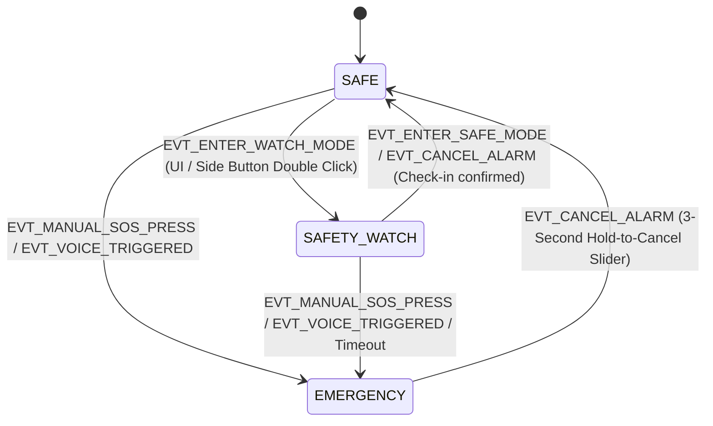

# SheShield Sentinel Watch OS — Technical Specification & Architecture Manual

**Project Name:** SheShield Sentinel (Naari OS Watch Firmware)  
**Target Hardware:** Waveshare ESP32-S3-Touch-AMOLED-2.06 with SIM800L GSM/GPRS Fallback  
**OS Architecture:** Modular FreeRTOS Real-Time Operating System with Event-Driven State Machine & LVGL/Custom Touch GUI  
**License:** Apache-2.0  

---

## 1. Executive Summary & Purpose

**SheShield Sentinel Watch OS** is an autonomous, standalone wearable operating system engineered specifically for women's personal safety, distress signaling, and high-reliability emergency management. 

Unlike conventional smartwatches that rely heavily on smartphone Bluetooth tethering, SheShield Sentinel is built from the ground up to operate completely independent of a mobile phone. It integrates on-device edge AI voice recognition, robust multi-sensory physical gestures, continuous GSM/GPRS cellular communication, high-decibel acoustic siren alarms, forensic evidence recording to MicroSD storage, and real-time cloud dashboard synchronization.

---

## 2. System Hardware & Chipset Architecture

The Watch OS runs on the **Waveshare ESP32-S3-Touch-AMOLED-2.06** development platform paired with an external **SIM800L GSM/GPRS module**.

```
                   ┌─────────────────────────────────────────────────────────┐
                   │          Waveshare ESP32-S3-Touch-AMOLED-2.06           │
                   │                                                         │
                   │  ┌──────────────┐   ┌──────────────┐   ┌─────────────┐  │
                   │  │  CO5300 2.06"│   │ FT3168 Touch │   │   QMI8658   │  │
                   │  │ 410x502 QSPI │   │     I2C      │   │ 6-Axis IMU  │  │
                   │  └──────────────┘   └──────────────┘   └─────────────┘  │
                   │  ┌──────────────┐   ┌──────────────┐   ┌─────────────┐  │
                   │  │ ES7210/ES8311│   │   AXP2101    │   │  PCF85063   │  │
                   │  │ Audio/DualMic│   │     PMIC     │   │  I2C RTC    │  │
                   │  └──────────────┘   └──────────────┘   └─────────────┘  │
                   │  ┌──────────────┐                                       │
                   │  │  MicroSD Slot│                                       │
                   │  │  FATFS Logger│                                       │
                   │  └──────────────┘                                       │
                   └───────────────────────────┬─────────────────────────────┘
                                               │ UART (TX: GPIO17, RX: GPIO18)
                                               ▼
                                  ┌─────────────────────────┐
                                  │   SIM800L GSM / GPRS    │
                                  │  - SMS SOS Broadcast    │
                                  │  - Auto-Voice Call      │
                                  │  - HTTP Alert Ingestion │
                                  └────────────┬────────────┘
                                               │
                       ┌───────────────────────┴───────────────────────┐
                       ▼                                               ▼
          ┌─────────────────────────┐                     ┌─────────────────────────┐
          │     Cloud Backend       │ ◄─── WebSocket ───► │ Emergency Contact Portal│
          │  - Alert Ingestion API  │                     │   (Live Telemetry, SOS  │
          │  - SMS Webhook Relay    │                     │   Audio Evidence Player)│
          └─────────────────────────┘                     └─────────────────────────┘
```

### Core Hardware Specifications

| Subsystem | Component | Bus Interface | Details |
| :--- | :--- | :--- | :--- |
| **SoC** | ESP32-S3R8 | Internal | Dual-core Xtensa LX7 @ 240 MHz, 512 KB SRAM, 8 MB Octal PSRAM, 32 MB SPI Flash |
| **Display** | CO5300 AMOLED | High-Speed QSPI (80 MHz) | 2.06-inch, 410 × 502 pixels resolution, vibrant color rendering |
| **Touch Panel** | FT3168 | I2C (`0x38`) | Capacitive Multi-touch controller with interrupt line |
| **Motion Sensor** | QMI8658 | I2C (`0x6B`) | 6-Axis IMU (3-axis Accelerometer + 3-axis Gyroscope) |
| **Power Management** | AXP2101 | I2C (`0x34`) | Smart PMIC, LiPo battery charger, fuel gauge %, power key monitor |
| **Audio Input** | ES7210 | I2C (`0x40`) + I2S | Dual MEMS digital mic ADC for voice trigger & background recording |
| **Audio Output** | ES8311 | I2C (`0x18`) + I2S | Low-power audio DAC connected to high-decibel siren speaker |
| **Real-Time Clock** | PCF85063 | I2C (`0x51`) | Ultra-low-power RTC for hardware evidence timestamping |
| **Cellular Module** | SIM800L | UART1 (115200 Baud) | Quad-band GSM/GPRS module for SMS SOS, voice call, and GPRS HTTP pings |
| **Local Storage** | MicroSD Card Slot | SDMMC / SPI | FATFS partition for continuous blackbox audio & incident logs |

---

## 3. Comprehensive Pinout & Interconnect Matrix

| Functional Bus | Signal Name | ESP32-S3 GPIO | Connected Peripheral Pin | Description |
| :--- | :--- | :--- | :--- | :--- |
| **System I2C Bus** | `I2C_SDA` | **GPIO 6** | SDA (All I2C chips) | Shared I2C Data (400 kHz Fast Mode) |
| | `I2C_SCL` | **GPIO 7** | SCL (All I2C chips) | Shared I2C Clock |
| **AMOLED QSPI** | `QSPI_CS` | **GPIO 9** | Display CS | Chip Select |
| | `QSPI_SCK` | **GPIO 10** | Display SCK | 80 MHz Clock |
| | `QSPI_D0` | **GPIO 11** | Display D0 | Quad-SPI Line 0 |
| | `QSPI_D1` | **GPIO 12** | Display D1 | Quad-SPI Line 1 |
| | `QSPI_D2` | **GPIO 13** | Display D2 | Quad-SPI Line 2 |
| | `QSPI_D3` | **GPIO 14** | Display D3 | Quad-SPI Line 3 |
| | `DISPLAY_RST` | **GPIO 8** | Display RST | Hardware Reset Line |
| | `DISPLAY_TE` | **GPIO 15** | Display TE | Tearing Effect Synchronization |
| **Capacitive Touch**| `TOUCH_INT` | **GPIO 4** | FT3168 INT | Active LOW Interrupt |
| | `TOUCH_RST` | **GPIO 5** | FT3168 RST | Hardware Reset |
| **Audio I2S** | `I2S_MCLK` | **GPIO 16** | MCLK | Audio Master Clock |
| | `I2S_BCLK` | **GPIO 38** | BCLK | Audio Bit Clock |
| | `I2S_LRCK` | **GPIO 39** | WS / LRCK | Word Select / Frame Clock |
| | `I2S_DOUT` | **GPIO 40** | ES8311 DIN | Audio Output Stream to DAC |
| | `I2S_DIN` | **GPIO 41** | ES7210 DOUT | Audio Input Stream from Mics |
| **MicroSD Slot** | `SD_CLK` | **GPIO 47** | SD CLK | SD Interface Clock |
| | `SD_CMD` | **GPIO 48** | SD CMD | SD Interface Command Line |
| | `SD_D0` | **GPIO 45** | SD D0 | SD Data Line 0 |
| **SIM800L Cellular**| `SIM_TX` | **GPIO 17** | SIM800L RXD | ESP32-S3 UART1 Transmit |
| | `SIM_RX` | **GPIO 18** | SIM800L TXD | ESP32-S3 UART1 Receive |
| | `SIM_PWRKEY` | **GPIO 2** | PWRKEY | Module Power Pulse Control |
| | `SIM_RST` | **GPIO 1** | RST | Module Hardware Reset |
| **Physical Button** | `SOS_BTN` | **GPIO 0** | BOOT / SOS Key | Active LOW Multi-Press SOS Key |

---

## 4. FreeRTOS Core & Three-Tier State Machine Engine

The Watch OS operates under a strict three-tier hierarchical state machine (`StateMachine`), backed by FreeRTOS timers and event queues.



### System States Detailed

#### 1. `SystemState::SAFE` (Normal Operational Mode)
- **Primary Function:** Daily clock interface, activity tracking, diagnostics, and background alert monitoring.
- **Power Profile:** AMOLED optimized refresh (30 Hz), IMU background telemetry (10 Hz), SIM800L in low-power idle standby mode.
- **Active Triggers:** Physical button multi-press, side power button long press, ESP-SR offline voice detection ("Help Me" / "Bachao").

#### 2. `SystemState::SAFETY_WATCH` (High Alert Guard / Night Walk Mode)
- **Primary Function:** Elevated situational awareness when navigating high-risk environments or walking alone at night.
- **Behavior & Peripherals:**
  - SIM800L module fully powered on and registered to cellular tower.
  - Active check-in countdown timer: wearer must confirm safety via UI check-in button.
  - Periodic GPRS/SMS telemetry pings containing GSM cell tower coordinates sent to cloud/contacts.
  - Core 0 runs continuous neural audio analysis via ESP-SR.

#### 3. `SystemState::EMERGENCY` (SOS Distress Broadcast Mode)
- **Primary Function:** Immediate multi-channel panic dispatch and legal evidence gathering.
- **10-Second Grace Cancellation Window:** Gives user time to cancel false alarms before siren & cellular dispatch.
- **Active Dispatch Sequence (Once Grace Window Expires):**
  1. **Acoustic Siren:** High-decibel warning pulse via ES8311 DAC and piezo speaker.
  2. **Structured SMS Broadcast:** Async SIM800L transmission to all pre-configured emergency contacts containing wearer name, distress state, battery %, and live GSM location coordinates.
  3. **Auto-Dialing Speakerphone Link:** SIM800L initiates a cellular call to the primary contact with dual-mic feed open.
  4. **MicroSD Forensic Recording:** Continuous 16 kHz uncompressed WAV audio logging to `/sdcard/evidence_INC_<TIMESTAMP>.wav`.
  5. **BLE Distress Beaconing:** High-power BLE 5.0 beaconing broadcasting emergency packets to nearby smartphones.
  6. **Cloud API Sync:** WebSocket / HTTP alert ingested into backend dashboard.

---

## 5. GUI & Screen Navigation System (12 Interactive Screens)

The UI layer (`UiManager`) provides 12 customized, responsive screen layouts designed for high contrast and rapid access.

```
                  ┌──────────────────────────────┐
                  │    SCREEN_SAFE (Clock Face)  │
                  └──────────────┬───────────────┘
                                 │ Swipe Up / Launchpad Button
                                 ▼
                  ┌──────────────────────────────┐
                  │  SCREEN_LAUNCHPAD (App Grid) │
                  └──────────────┬───────────────┘
                                 │
     ┌───────────────────────────┼───────────────────────────┐
     ▼                           ▼                           ▼
┌───────────────┐       ┌─────────────────┐       ┌─────────────────┐
│ CONTROL_CTR   │       │ SOUND_STUDIO    │       │ FLASHLIGHT      │
└───────────────┘       └─────────────────┘       └─────────────────┘
     │                           │                           │
     ▼                           ▼                           ▼
┌───────────────┐       ┌─────────────────┐       ┌─────────────────┐
│ TELEMETRY     │       │ SYSTEM DIAG     │       │ CONTACTS        │
└───────────────┘       └─────────────────┘       └─────────────────┘
     │                           │                           │
     ▼                           ▼                           ▼
┌───────────────┐       ┌─────────────────┐       ┌─────────────────┐
│ DIALER        │       │ SAFETY_WATCH    │       │ EMERGENCY (SOS) │
└───────────────┘       └─────────────────┘       └─────────────────┘
                                                             │
                                                             ▼
                                                  ┌─────────────────┐
                                                  │ CANCEL SLIDER   │
                                                  └─────────────────┘
```

### Screen Breakdown

1. **`SCREEN_SAFE` (macOS Minimal Clock Face)**
   - Features: Time display, date, dynamic top island pill (showing SIM CSQ & battery status), animated activity rings, floating dock for fast access to SOS and Guard mode.
2. **`SCREEN_LAUNCHPAD` (App Grid UI)**
   - macOS-inspired 3 × 4 grid layout displaying all watch micro-apps with sleek rounded icon tiles.
3. **`SCREEN_SOUND_STUDIO` (Distress Siren Soundboard)**
   - Allows direct trigger and testing of 5 alarm sound profiles: *Police Siren, Pulse Siren, Hi-Lo Warning, Chirp, and Chime*, complete with master volume control.
4. **`SCREEN_CONTROL_CENTER` (Quick Settings HUD)**
   - 2 × 2 control grid providing instantaneous toggles for Battery status, 4G Signal details, AMOLED Flashlight, and Silent SOS mode.
5. **`SCREEN_FLASHLIGHT` (Multi-Mode AMOLED Torch)**
   - High-luminance screen torch featuring 3 selectable operating modes: *100% White Light*, *Warm Amber*, and *High-Visibility Red Strobe*.
6. **`SCREEN_TELEMETRY` (Motion & Sensor HUD)**
   - Displays real-time sensor feedback from the QMI8658 6-axis IMU: live G-Force reading, artificial horizon tilt level, and electronic compass header.
7. **`SCREEN_SYSTEM` (Hardware Diagnostics HUD)**
   - Live hardware status monitoring: AXP2101 power rail voltage, SIM800L module registration & CSQ, free internal DRAM / Octal PSRAM.
8. **`SCREEN_WATCH` (Night Walk / Safety Trip HUD)**
   - Guard session control center featuring session timer, check-in countdown ring, and one-tap "I Am Safe" confirmation.
9. **`SCREEN_EMERGENCY` (Distress SOS Screen)**
   - High-visibility red alert HUD activated during an active emergency state. Displays grace countdown, alert dispatch status, and instant cancel option.
10. **`SCREEN_CONTACTS` (Emergency Contact Directory)**
    - Displays stored emergency contacts with one-touch **Tap-to-Call** and **Tap-to-SMS** capability.
11. **`SCREEN_DIALER` (Standalone Phone Keypad)**
    - Apple Watch-style 3 × 4 keypad allowing manual cellular phone number entry and outgoing voice call dialing via SIM800L.
12. **`SCREEN_CANCEL` (Hold-to-Cancel Slider)**
    - Dedicated safety screen preventing accidental alarm cancellations; requires a continuous 3-second hold to return the system to `SAFE` mode.

---

## 6. Firmware Subsystems & Drivers Architecture

### 1. `SIM800L` Cellular Driver (`sim800l.h` / `sim800l.cpp`)
- Built as an asynchronous, thread-safe FreeRTOS task communicating via UART1 (`115200 Baud`).
- Maintains continuous health state (`SimPowerState`, `NetworkRegStatus`, `csq`, `rssiDbm`).
- Handles AT command queuing (`REQ_SEND_SMS`, `REQ_FETCH_LOCATION`, `REQ_VOICE_CALL`).
- Features coarse GSM location retrieval (`AT+CIPGSMLOC`) by querying nearest cellular towers.

### 2. `AXP2101` PMIC & Power Management (`axp2101.h` / `axp2101.cpp`)
- Configures power rails for AMOLED display, audio DAC, touch controller, and SIM800L.
- Provides precise battery fuel gauge percentage and charging status callbacks over I2C (`0x34`).
- Monitors the physical PEK side button for short presses (UI navigation) and long presses (instant SOS trigger).

### 3. `VoiceTrigger` Edge AI (`voice_trigger.h` / `voice_trigger.cpp`)
- Utilizes ESP-SR neural network model running on Core 0.
- Samples dual MEMS microphones via ES7210 ADC over I2S at 16 kHz.
- Operates offline in zero-connectivity environments, recognizing key distress phrases: *"Help Me"*, *"Bachao"*, and *"Save Me"*.

### 4. `SdLogger` Forensic Blackbox (`sd_logger.h` / `sd_logger.cpp`)
- Manages MicroSD card mounting and FATFS file system access.
- Automatically creates timestamped evidence files (`/sdcard/evidence_INC_<TIMESTAMP>.wav`) upon entering `EMERGENCY` mode.
- Records uncompressed 16-bit PCM audio directly alongside system state logs.

### 5. `AudioManager` Siren Subsystem (`audio_manager.h` / `audio_manager.cpp`)
- Interfaces with ES7210 dual mic ADC (`0x40`) and ES8311 audio DAC (`0x18`).
- Synthesizes dynamic digital siren waveforms (Police sweep, high-frequency pulse) for high-decibel alarm output.

### 6. `ImuQMI8658` Motion Subsystem (`imu_qmi8658.h` / `imu_qmi8658.cpp`)
- Samples 3-axis acceleration and 3-axis angular rate at 50 Hz over I2C (`0x6B`).
- Provides real-time motion telemetry for UI horizon gauges and telemetry HUD.

---

## 7. FreeRTOS Task Execution Matrix

The Watch OS spawns dedicated FreeRTOS tasks pinned across the ESP32-S3's dual Xtensa cores to ensure real-time responsiveness.

| Task Name | Function | Priority | Stack Size | Core Pinning | Description |
| :--- | :--- | :--- | :--- | :--- | :--- |
| `btn_task` | Button & Power Key cadence | **6** (Highest) | 3,072 Bytes | Core 1 | Processes physical button debouncing, double-clicks, triple-presses, and side PEK key events. |
| `imu_task` | IMU Telemetry Sampler | **5** | 3,072 Bytes | Core 1 | 50 Hz background motion acquisition. |
| `ui_task` | LVGL GUI Rendering Tick | **4** | 4,096 Bytes | Core 1 | 15 ms tick loop for smooth AMOLED animations and touch handling. |
| `sim_task` | SIM800L Async AT Manager | **4** | 4,096 Bytes | Core 0 | Handles non-blocking UART AT commands, SMS transmission, and cellular call control. |
| `voice_task` | ESP-SR Speech Inference | **3** | 6,144 Bytes | Core 0 | Continuous audio buffer sampling & neural wake phrase recognition. |
| `net_task` | Wi-Fi / Cloud Ingestion | **2** | 3,072 Bytes | Core 0 | Background HTTP / WebSocket API sync when Wi-Fi is connected. |

---

## 8. Physical Controls, Gestures & Apple Watch UI Architecture

### 8.1 Physical Button Architecture (Digital Crown & Side Button)

SheShield Sentinel implements dedicated physical control mappings designed for rapid tactile access under high stress:

| Physical Control | Action | Function & Navigation Flow |
| :--- | :--- | :--- |
| **Digital Crown (BOOT / GPIO 0)** | **Single Click** | **Watch Face ↔ Honeycomb Launcher Toggle**: If on Watch Face, opens the Honeycomb SpringBoard. If in any sub-app (Sound Studio, Torch, Compass, Contacts, Dialer, etc.), smoothly navigates home to Watch Face. |
| | **Double Click** | **Quick App Switch**: Instantly toggles between the active app and the previously visited screen. |
| | **Triple Click** | **Immediate Emergency SOS**: Debounced panic trigger initiating the 30-second countdown and alert protocols. |
| | **Long Press (> 2.0s)** | **Immediate Emergency SOS**: Hardware panic hold triggering the distress sequence. |
| **Side Power Key (AXP2101 PMIC)** | **Single Click** | **Control Center Toggle**: Opens quick settings tiles (Cellular, Battery, Torch, Siren, SOS) from any screen; or immediately ends an active call on the Calling Overlay. |
| | **Long Press (> 2.0s)** | **Emergency SOS Launch**: Hardware power-rail emergency interrupt triggering full SOS. |

### 8.2 Apple Watch Honeycomb SpringBoard Launcher (Hexagonal Icon Cloud)

Inspired by the official Apple Watch watchOS SpringBoard architecture, the App Drawer features:
- **Hexagonal Lattice Topology**: 12 curated system apps arranged on a staggered 2D hexagonal coordinate grid ($\Delta X = 96\text{ px}, \Delta Y = 84\text{ px}$).
- **Spherical Fish-Eye Lens Distortion**: Real-time radial perspective scaling ($R_{sphere} = 220\text{ px}$). Apps centered on the screen are magnified ($1.12\times$ scale, 70 px diameter) with detailed SF-symbols, while peripheral icons smoothly compress ($0.44\times$ scale, 28 px diameter) towards the curved AMOLED bezel.
- **Inertial Kinetic Physics & Momentum**: Continuous touch drag tracking with velocity momentum ($0.88\times$ decay per tick) and restorative elastic rubber-band boundaries past $\pm 120\text{ px}$.
- **Dynamic Center App HUD**: A floating glass capsule HUD at the screen bottom automatically identifies and displays the name of whichever app is currently centered in view.
- **Touch Hit-Testing**: Evaluates distance against dynamic scaled icon radii for single-tap app launch with zero latency.

### 8.3 30-Second Emergency SOS Protocol & Overlays

1. **Second-Wise 30-Second Countdown**:
   - Synchronized single-source-of-truth 1-second ticks driven by hardware RTC and FreeRTOS timer.
   - Depleting radial progress ring arc on AMOLED screen with pulsating high-contrast crimson warning header.
   - Hold-to-disarm slider allows 2-second touch cancellation before alert dispatch.
2. **Outgoing Emergency Calling Overlay (`SCREEN_CALLING`)**:
   - Prominent caller avatar, pulsing green status banner, dialed number, live elapsed call timer (`MM:SS`).
   - Interactive glass controls for Mute, Keypad, Speaker, and high-visibility crimson **End Call** button.
3. **Emergency SMS Delivery Overlay (`SCREEN_SMS_SENT`)**:
   - Distinctive iMessage-style glass capsule with animated delivery checkmark badge.
   - Contact dispatch confirmation and attached GPS coordinate status badge. Auto-dismisses smoothly after 4 seconds or on tap.

---

## 9. Verification & Build System

The firmware is compiled using the official ESP-IDF v5.1+ toolchain:

```bash
# Set target chip
idf.py set-target esp32s3

# Build full Watch OS firmware image
idf.py build

# Flash to device via USB-C serial port
idf.py -p /dev/ttyUSB0 flash monitor
```

---

## 10. Summary

SheShield Sentinel Watch OS represents a complete, production-grade safety wearable architecture. By marrying edge AI offline voice detection, redundant cellular SMS/voice communication, high-speed AMOLED graphics, and forensic audio blackbox logging into a unified FreeRTOS framework, the system delivers uncompromised safety and reliability in critical situations.
